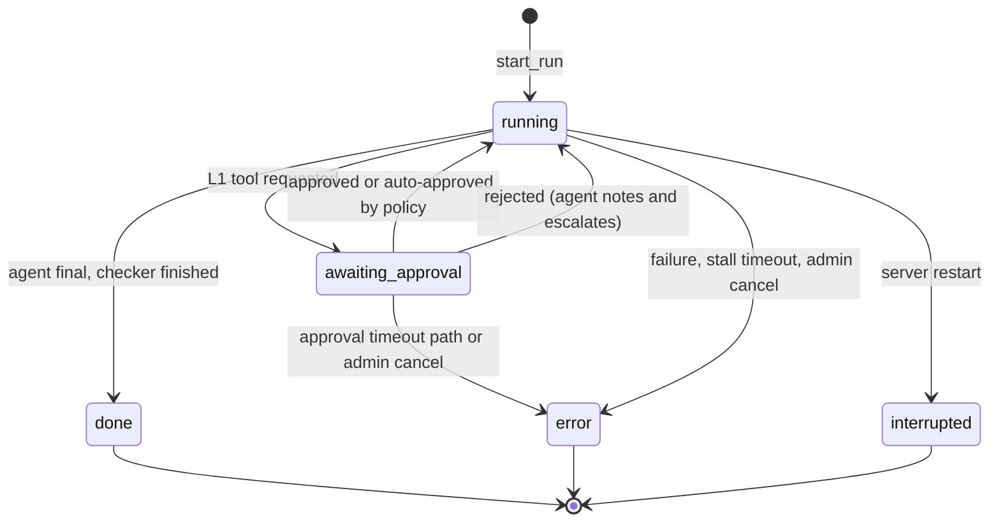

# TRIAGE-1: Architecture, High-Level and Low-Level Design

| | |
|---|---|
| Document version | v1.0 |
| Date | 2026-10-19 |
| Owner | Veda (project owner) |
| Basis | Repo dump `project_code_1.txt` (2026-10-19), roadmap `TRIAGE-1_Roadmap_and_Design.md` v0.6, and the changes applied in the 2026-10-19 working session (P3 completion, P1 withdraw, duplicate-guard fixes, CMDB service context, chat tickets through the job queue) |
| Companion | The roadmap file holds phases, exit criteria and the decision log. This file describes how the system is built |
| Reading note | Status words used below: **built** = in the repo, **verified** = owner tested live, **pending** = built but not yet tested live, **not built** = planned only |

---

## 1. Purpose, scope and constraints

TRIAGE-1 is an L1 SRE assistant. It does two jobs for one operations team:

1. **Chat assistant.** Engineers and end users paste logs or describe a problem. The chat answers from the team's runbooks (hybrid RAG plus a knowledge graph), and can raise a ServiceNow incident.
2. **Ticket agent.** A single LangChain agent works ServiceNow incidents: it diagnoses, fixes low-risk problems, asks a human for anything riskier, verifies the result with an independent checker, and escalates (including a P1 with a disruption notice) when it cannot fix the problem.

### 1.1 Requirements covered

| ID | Requirement (short) | Where it lives |
|---|---|---|
| R1 | Admin console, three roles, approver workspace | `app/auth.py`, `app/api/admin.py`, `static/admin.html`, `static/agent.html` |
| R2 | Independent checker that closes or reopens tickets | `app/checker.py` |
| R3 | Ticket creation from chat (overlay, confirm or auto, undo) | `app/api/issues.py`, `static/js/script.js` |
| R4 | Playbooks in ServiceNow Knowledge | `app/agent/skills.py`, `scripts/push_skills_to_kb.py` |
| R5 | Autonomous intake from monitoring tickets | auto loop and dispatcher in `app/api/agent.py`, `app/jobs.py` |
| R6 | Autonomy by service criticality and action risk | `app/agent/policy.py` |
| R7 | Service context from the CMDB | `app/tools/cmdb.py` |
| R8 | P1 escalation, bridge link, one disruption notice | `app/escalation.py` |
| R9 | Chat on/off switch enforced on the server | `settings.chat_enabled`, `app/api/admin.py` |

### 1.2 Hard constraints

- **One model, one GPU.** Qwen2.5-7B-Instruct-AWQ on a Google Colab NVIDIA T4 (15 GB), reached through an ngrok URL (`COLAB_API_URL`) with a custom `/generate` endpoint that serves one request at a time.
- **Small prompts.** Target under 4K tokens per agent call. Measured average is 1.7K to 2.6K (section 2.7).
- **Safety in code, not in the prompt.** A 7B model is not a control. Risk classes, approvals, role checks and autonomy limits are enforced by code.
- **Owner applies code by hand.** Changes are delivered as files or "current snippet / replace snippet" pairs.

### 1.3 Non-goals (current)

SSO (the login page and session cookie satisfy D-05 for now), separate model instances per agent, an LLM-driven orchestrator, a ServiceNow webhook (polling is sufficient), and per-incident bridge creation (one standing link is used).

---

# PART A. HIGH-LEVEL DESIGN

## 2. High-level design

### 2.1 System context

| Actor or system | Role | Interface |
|---|---|---|
| End user (role `viewer`) | Reports problems in chat, sees their ticket progress | Browser: `index.html` |
| Approver (L2 engineer, role `approver`) | Approves or rejects agent actions, declares P1 | Browser: `agent.html` |
| Admin (role `admin`) | Manages users, switches, KB, metrics. Has no chat window | Browser: `admin.html`, `knowledge.html` |
| ServiceNow (developer instance) | Tickets, work notes, SLAs, Knowledge (playbooks), CMDB | REST Table API, two service accounts (agent and checker) |
| Colab model server | Generates text for chat and agent steps | HTTPS POST `/generate` (streaming for chat) |
| Supabase | Postgres store for all app data, pgvector search (`hybrid_search` RPC) | supabase-py with the secret key |
| Neo4j AuraDB | Knowledge graph (`Entity` -[`RELATED_TO`]-> `Entity`) | Bolt driver |
| AWS | EC2 inventory (names, IPs), CloudWatch, SNS notices, Lambda L3 notify | boto3 |
| Victim servers | Linux (SSH) and Windows (WinRM, AD) hosts the agent inspects and fixes | paramiko, pywinrm |
| Monitoring (for example Zabbix) | Creates incidents in the agent's assignment group | Through ServiceNow only |

### 2.2 Logical architecture

<!-- fig: logical -->
```
+----------------------- BROWSER (static pages, Tailwind CDN) ------------------------+
| login.html | index.html (chat) | agent.html (approver) | knowledge.html | admin.html |
+-------------------------------------+---------------------------------------------+
                                      | HTTPS, JSON, SSE (chat)    session cookie
+-------------------------------------v---------------------------------------------+
|                    FastAPI application (app/main.py, uvicorn)                     |
|   Auth middleware: session -> user -> role gate (app/auth.py)                     |
|  +-----------+  +-------------+  +-------------+  +-------------+  +------------+ |
|  | Chat+RAG  |  | Issues      |  | Agent API   |  | Admin API   |  | Auth,Health| |
|  | main.py   |  | api/issues  |  | api/agent   |  | api/admin   |  | api/auth   | |
|  +-----+-----+  +------+------+  +------+------+  +------+------+  +------------+ |
|        |               |                |                |                        |
|  +-----v---------------v----------------v----------------v----------------------+ |
|  | Core: run engine (RUNS, dispatcher, watchdog, auto loop) | jobs | llm gate    | |
|  |       policy | skills | checker | escalation | cmdb | store | usage           | |
|  +--+------------+------------+-------------+-----------+-----------+------------+ |
+-----|------------|------------|-------------|-----------|-----------|--------------+
      v            v            v             v           v           v
  Colab T4     ServiceNow    Supabase       Neo4j        AWS      Linux / Windows / AD
  /generate    Table API     Postgres +     AuraDB    EC2, SNS,   victim servers
  Qwen2.5-7B   KB, CMDB      pgvector                 Lambda      (SSH, WinRM)
```

**Layers**

| Layer | Responsibility | Main code |
|---|---|---|
| Presentation | Static HTML and JS pages, role-aware | `static/` |
| API | HTTP routes, role gate, validation | `app/main.py`, `app/api/*.py`, `app/auth.py` |
| Domain services | Run engine, job queue, policy, playbooks, checker, escalation, CMDB context | `app/api/agent.py`, `app/jobs.py`, `app/agent/*`, `app/checker.py`, `app/escalation.py`, `app/tools/cmdb.py` |
| Tools | The only code that touches external systems on behalf of the agent | `app/tools/snow.py`, `infra.py`, `aws.py`, `aws_tools.py`, `cmdb.py` |
| Platform | LLM access and gate, persistence | `app/llm/*`, `app/store.py` |

### 2.3 Design principles

1. **The code decides, the model proposes.** The code picks the server (from AWS instance names in the ticket), picks the playbook (keyword score, whole-word), limits the tools to those the playbook lists, and decides whether an action needs approval. The model only chooses the next tool call inside those limits.
2. **Risk is a table, not a prompt.** `RISK` in `app/agent/policy.py` assigns L0 to L3. A tool missing from the table counts as L2. L1 and above need a human unless the narrow autonomous-restore rule applies.
3. **Maker-checker.** The agent never closes its own work. A deterministic checker with its own ServiceNow account re-verifies and closes or reopens.
4. **Fail closed.** If the CMDB cannot be read, a restart waits for approval. If the checker cannot verify, the ticket stays Resolved for a person. If the notice send fails, the P1 shows "declared, notice not sent" and is retried.
5. **One run at a time.** One model and one set of "active server" state (`aws.ACTIVE`) mean a single run slot. Everything else waits in a durable priority queue.
6. **Everything important is audited.** Starts, approvals, autonomy decisions, P1 steps, admin changes and ticket undo all write to `audit` under the actor's id.
7. **Degrade, do not die.** Chat retrieval failures (graph or vector) are logged and the chat continues. Store helpers log and return on failure rather than raising.

### 2.4 Main runtime flows

**Flow 1: chat to ticket to closed.**

1. The user describes a problem. `POST /api/chat` returns an SSE stream with retrieved sources and, if the text looks like a live issue, an `incident` hint.
2. The UI shows a one-line card: "Create an incident for <server>?" (confirm mode) or raises it at once with a 30 s Undo (auto mode).
3. `POST /api/issues` creates the ServiceNow incident (caller from the session, CI from the chosen server), saves the transcript as a work note, and then starts the run or queues it.
4. The agent claims the ticket, picks the playbook, calls read-only tools, and, for a fix, either waits for approval or (critical service in `on` autonomy mode) restores it by policy.
5. At the end of the run the checker re-verifies with its own account, posts one report, and closes or reopens the ticket. A failed check proposes a P1.
6. The chat shows the outcome and the L2 SLA message if the ticket was escalated.

**Flow 2: monitoring ticket.** The auto loop polls the L1 queue (active, New, unassigned, group `L1-SRE-Agent`, priority then age) and enqueues tickets. The dispatcher starts them one at a time. Nothing in the UI is clicked.

**Flow 3: P1.** A proposal is created when verification fails, the 15-minute budget runs out (runs that touched a critical service), or an approval times out. An approver edits the notice text and declares. The code sets impact and urgency to 1, adds the bridge link as a work note, publishes one notice (SNS), and records it. A proposal is withdrawn automatically if the run ends resolved and verified.

### 2.5 Deployment view

<!-- fig: deployment -->
```
 Operator PC / VDI (Windows, Python 3.13 venv)          Cloud services
+--------------------------------------------+       +-----------------------------+
| uvicorn main:app  (single process)         |------>| Supabase (Postgres, pgvector)|
|  - FastAPI app and static pages            |------>| Neo4j AuraDB                 |
|  - background threads: dispatcher (2 s),   |------>| ServiceNow dev instance      |
|    watchdog (30 s), auto loop (15 s)       |------>| AWS: EC2 API, SNS, Lambda    |
|  - SQLite file: LangGraph checkpoint       |--SSH->| Linux victim (victim-test)   |
+--------------------+-----------------------+--WinRM>| Windows victim (term-win-srv)|
                     | HTTPS via ngrok       |       +-----------------------------+
                     v
        Google Colab (T4): /generate  -> Qwen2.5-7B-Instruct-AWQ
```

- The app is one process. Background work uses daemon threads inside it. There is no separate worker service.
- State that must survive a restart is in Supabase (runs, events, audit, approvals, users, sessions, settings, jobs, notices, verifications). The LangGraph checkpoint is a local SQLite file (`triage_checkpoints.db`, override with `CHECKPOINT_DB`). Moving it to Supabase Postgres is designed but deferred.
- In-memory only: the `RUNS` cache (last 20, rebuilt from the database on boot), the Undo and queue tracking for chat tickets (`_PENDING`), duplicate fingerprints (`_RECENT`), the per-user ticket rate counters, the autonomy flap counters, and the CMDB and playbook caches.

### 2.6 Security architecture

| Concern | Design |
|---|---|
| Authentication | Login page, bcrypt password hash in `users`, random session token stored hashed (SHA-256) in `sessions`, 7-day cookie `triage_session` (HttpOnly, SameSite=Lax, `Secure` when `COOKIE_SECURE=1`) |
| Authorization | Middleware maps each method and path to a minimum role (`viewer` < `approver` < `admin`) through `required_role`. Unknown paths default to `viewer`, so every new sensitive path needs an explicit rule (D-23) |
| Session freshness | Session lookups are cached 45 s, so a disabled user loses access within 45 s; role changes call an invalidate helper |
| Admin separation | Admin has no chat route (admin visiting `/` is redirected to `/admin`). Admin actions are audited under the admin's id |
| Data protection | Supabase backend uses the secret key; every table has RLS on with no public policy. Chat text is redacted (AWS keys, `password=`/`token=` patterns, bearer tokens) before it reaches ServiceNow or `rag_events` |
| Agent safety | Ticket text is treated as data (stated in the system prompt and by tool limits). Service names must match `^[A-Za-z0-9._-]{1,64}$` and the `SERVICE_ALLOWLIST`. Hosts come from AWS, never from the model |
| Maker-checker | The checker uses its own ServiceNow identity (`SNOW_CHECKER_USER`), read-only infra checks, no LLM |
| Known gaps | `COOKIE_SECURE` defaults to off; no startup check that rejects a publishable Supabase key; no SSO; notices go as plain text through SNS |

### 2.7 Quality attributes

**Reliability and restart behaviour**

| Situation | Result |
|---|---|
| Restart while a run is running | Run is marked `interrupted` and audited |
| Restart while a run awaits approval | Approval row survives; the SQLite checkpoint lets the run resume after the decision |
| Restart with jobs queued | Jobs are in Postgres and start when the slot is free |
| Restart inside a chat Undo window | The pending timer is lost; the ticket exists in ServiceNow and the chat falls back to a plain "created" message |
| Model server unreachable | Chat shows a readable error; an agent step fails the run; `/api/ready` reports degraded |

**Performance (measured on `llm_calls`, 2026-10-19)**

| Call kind | Calls | Avg prompt tokens | Max prompt tokens | Avg generation time |
|---|---|---|---|---|
| triage | 172 | 1,663 | 2,613 | 4.5 s |
| resume | 60 | 2,289 | 3,505 | 6.9 s |
| chat | 15 | 2,611 | 4,461 | 12.5 s |

A typical service-down run makes 8 to 10 model calls (13K to 23K prompt tokens in total, because each step re-sends the conversation) and takes about 70 to 150 s, which includes the 60 s checker soak. Nudges per run: 0. Gate wait: 0.0 s. Decision: the step-engine token reduction planned in P6 was dropped because per-call size is already under target.

**Observability.** `llm_calls` (tokens and latency per call), `runs` (outcome, steps, nudges, tokens), `audit`, `verifications`, `rag_events`, `/api/ready` (dependency checks), `/api/admin/api-health`, and the admin Performance, RAG and Health sections.

**Scalability limits.** One run at a time, one model, one process. These are deliberate for the T4 and the pilot. A larger model server or a second worker would be the first change if throughput matters.

### 2.8 Key decisions (summary)

| ID | Decision |
|---|---|
| D-05 | Login page with session cookie replaces HTTP Basic. SSO later |
| D-06, D-07 | "Agents" are profiles on one model; the orchestrator is deterministic code |
| D-08, D-09 | Checker is deterministic, read-only, with its own account |
| D-12 | Supabase Postgres for app data; RLS on; secret key on the backend |
| D-13 | One priority gate in front of the single model: resume > verify > triage > chat > ingest |
| D-17, D-22 | Risk table in code; autonomy mode `off`, `shadow` (default) or `on`, admin only |
| D-18 | CMDB service context; highest dependent criticality drives autonomy |
| D-19 to D-21, D-24 | P1 flow: proposal, approver edit, one notice per incident, SNS transport for the MVP |
| D-25 to D-29 | Checker runs inline at the end of a run, own identity, one consolidated report |

---

# PART B. LOW-LEVEL DESIGN

## 3. Low-level design

### 3.1 Code map

| Path | Purpose |
|---|---|
| `app/main.py` | App factory, static pages, chat endpoint (RAG, SSE), document and graph management, title generation |
| `app/auth.py` | Session middleware, role table `required_role`, session cache |
| `app/api/auth.py` | `POST /api/auth/login`, `/logout`, `GET /api/auth/me` |
| `app/api/agent.py` | Run engine: `RUNS`, `start_run`, `_consume`, approvals, P1 decision, watchdog, auto loop, dispatcher, status |
| `app/api/issues.py` | Chat ticketing: server and user type-ahead, create, duplicate guard, add note, Undo, queue follow |
| `app/api/admin.py` | Admin API: switches, users, audit, runs, metrics, settings, jobs |
| `app/api/health.py` | `GET /api/ready` dependency checks |
| `app/agent/agent.py` | LangChain agent, `start()`, `resume()`, nudges, checkpointer |
| `app/agent/hosts.py` | Resolves the affected server from the ticket text |
| `app/agent/policy.py` | `RISK` table, approval rule, autonomous-restore decision |
| `app/agent/skills.py` | Playbook loading (files or KB), validation, skill picking, versions |
| `app/agent/prompts.py`, `report.py` | Prompts; end-of-run report and `outcome_code` |
| `app/checker.py` | Independent verification and close or reopen |
| `app/escalation.py` | P1 proposal, draft, declare, transports |
| `app/jobs.py` | Durable job queue |
| `app/llm/colab_chat.py` | LangChain wrapper over `/generate` (text tool calling) |
| `app/llm/gate.py`, `usage.py` | Priority gate; token counting and `llm_calls` logging |
| `app/tools/snow.py` | ServiceNow tools and `_request` (two identities, retries) |
| `app/tools/infra.py` | Linux, Windows, AD tools |
| `app/tools/aws.py`, `aws_tools.py` | EC2 inventory and active-server state; AWS read tools; L3 notify |
| `app/tools/cmdb.py` | CMDB service context |
| `app/store.py` | Supabase persistence helpers |
| `skills/<name>/SKILL.md` | Playbooks (local copy and fallback) |
| `static/` | Pages: `index`, `agent`, `admin`, `knowledge`, `login`, `chat_off`; JS: `script.js`, `agent.js`, `agent_status.js`, `knowledge.js` |
| `scripts/`, `tests/` | Manual and live tests, simulations, push-to-KB, offline unit tests |

### 3.2 Data model (Supabase Postgres)

All tables have RLS enabled with no public policy. The backend reaches them with the secret key.

| Table | Key columns | Notes |
|---|---|---|
| `users` | `user_id` (email, PK), `name`, `role`, `type`, `status`, `password_hash`, `last_login` | Roles `viewer`, `approver`, `admin`. SNOW link columns are in the design but not populated |
| `sessions` | `token_hash` (PK), `user_id`, `created_at`, `expires_at` | Token stored hashed |
| `runs` | `id` (PK), `ticket`, `status`, `skill`, `skill_version`, `server`, `thread_id`, `created`, `updated`, `started`, `ended`, `requester`, `outcome`, `steps`, `nudges`, `tokens_in`, `tokens_out`, `llm_calls` | Status: `running`, `awaiting_approval`, `done`, `error`, `interrupted` |
| `events` | `run_id`, `seq`, `ts`, `body` (JSON) | One row per run event, replayed after a restart |
| `approvals` | `id` (PK), `run_id`, `ticket`, `tool`, `args_json`, `risk`, `requested_at`, `decided_at`, `decided_by`, `decision`, `comment` | Open row = `decided_at` null |
| `audit` | `ts`, `run_id`, `ticket`, `actor`, `action`, `detail` | Append only |
| `llm_calls` | `ts`, `kind`, `run_id`, `tokens_in`, `tokens_out`, `gen_s`, `wait_s` | One row per model call |
| `verifications` | `ticket`, `run_id`, `ts`, `mode`, `verdict`, `checks_json`, `reopen_count`, `closed_at` | Verdict `pass`, `fail`, `unverified`; mode `shadow` or `on` |
| `notices` | `id`, `incident`, `run_id`, `type`, `sent_at`, `approver`, `message_id`, `recipients_json`, `body` | Unique per (`incident`, `type`) |
| `settings` | `key` (PK), `value_json`, `updated_by`, `updated_at` | See 3.3 |
| `jobs` | `id` (PK), `ticket`, `source`, `actor`, `priority`, `status`, `created` | Status `queued`, `started`, `cancelled`, `expired` |
| `rag_events` | `ts`, `user_hash`, `query`, `kind`, `retrieved`, `scores`, `graph_hits`, `cited`, `phantom`, `t_graph`, `t_vec`, `t_total` | Query is redacted; retention from settings |
| `sre_runbooks` | content, embedding, metadata | RAG chunks; searched by the `hybrid_search` RPC |

Neo4j: nodes `Entity {name}`, relationships `RELATED_TO {type, source document}`. Deleting a document removes its vectors and only the edges that came from it.

### 3.3 Settings keys (`settings` table, 5 s read cache)

| Key | Default | Changed by | Meaning |
|---|---|---|---|
| `chat_enabled` | true | Admin | Server-side chat switch |
| `auto_enabled` | false | Admin, circuit breaker | Auto-intake loop on or off (persisted, resumed at boot) |
| `autonomy_mode` | `shadow` | Admin | `off`, `shadow`, `on` |
| `ticket_mode` | `confirm` | Admin | Chat ticket creation: `confirm` or `auto` |
| `p1_notice_to`, `p1_notice_cc` | [] | Admin | Notice recipients (used by SMTP and SES) |
| `bridge_link` | "" | Admin | Standing bridge link added to P1 tickets and notices |
| `approval_timeout_min` | 30 | Admin | Auto-reject threshold |
| `rag_retention_days` | 30 | Admin | Retention for `rag_events` |
| `manual_minutes_per_ticket` | 20 | Admin | Used for the "hours saved" estimate |

### 3.4 API reference

Role = minimum role. "Any" means any logged-in user. Paths under `/api/agent` default to `approver`.

**Auth and status**

| Method and path | Role | Purpose |
|---|---|---|
| `POST /api/auth/login`, `POST /api/auth/logout`, `GET /api/auth/me` | none, any | Session handling |
| `GET /api/chat/status` | Any | Chat switch and ticket mode for the UI |
| `GET /api/health`, `GET /api/ready` | Any | Model ping; dependency readiness (LLM, ServiceNow, AWS, database) |

**Chat and knowledge**

| Method and path | Role | Purpose |
|---|---|---|
| `POST /api/chat` | Any | RAG chat, SSE response. Returns 403 when chat is off |
| `POST /api/title` | Any | Short chat title |
| `GET /api/rag/documents`, `GET /api/rag/graph` | Approver | List documents and graph edges |
| `POST /api/rag/upload`, `DELETE /api/rag/documents/{filename}` | Admin | Ingest or remove a document (vectors and graph) |
| `POST /api/rag/graph`, `DELETE /api/rag/graph`, `POST /api/rag/graph/upload` | Admin | Edit the graph, CSV import |

**Chat ticketing (`/api`)**

| Method and path | Role | Purpose |
|---|---|---|
| `GET /servers`, `GET /users` | Any | Type-ahead (AWS instance names, ServiceNow users) |
| `POST /issues` | Any | Create the ticket, then start or queue the run |
| `GET /issues/open?server=` | Any | Caller's open tickets on a server (duplicate guard) |
| `POST /issues/{number}/note` | Any | Add the user's text to their own open ticket |
| `GET /issues/{number}/run` | Any | State of a pending ticket: `waiting`, `starting`, `queued`, `started`, `failed`, `undone`, with `run_id`, `position`, `seconds_left` |
| `POST /issues/{number}/undo` | Any | Cancel during the Undo window |
| `GET /issues/{number}/sla` | Any | Response and resolution times for the L2 message |

**Agent (`/api/agent`)**

| Method and path | Role | Purpose |
|---|---|---|
| `GET /queue`, `GET /runs`, `GET /approvals`, `GET /status`, `GET /llm-stats`, `GET /skills-status` | Approver | Console data |
| `POST /run` | Approver | Start or queue a ticket (priority 1) |
| `GET /runs/{id}` | Any | Run events and outcome (end users poll their own run) |
| `GET /live` | Any | Live banner |
| `POST /runs/{id}/decision` | Approver | Approve or reject (comment required on reject) |
| `POST /runs/{id}/p1` | Approver | Declare or dismiss a P1 proposal |
| `GET /audit`, `GET /auto`, `POST /auto` | Admin | Audit view; auto-intake switch |

**Admin (`/api/admin`, admin only)**

`chat`, `autonomy`, `p1`, `ticket-mode`, `settings` (get and set); `users` (list, add, patch); `audit` and `audit.csv`; `runs`, `runs/{id}/cancel`, `runs/{id}/rerun`; `jobs`, `jobs/{id}/cancel`; `bot-stats`, `rag-stats`, `summary`, `api-health`.

### 3.5 Roles and page access

| Page or capability | viewer (End user) | approver | admin |
|---|---|---|---|
| Chat (`/`) | Yes (admin is redirected to `/admin`) | Yes | No |
| Agent Console (`/agent`), approvals | No (403) | Yes | Yes |
| KB pages (`/knowledge`) | No | Read | Full |
| Admin console (`/admin`, `/api/admin/*`, `/api/agent/auto`, audit) | No | No | Yes |

### 3.6 Agent core

**Model wrapper.** `ColabChat` (LangChain `BaseChatModel`) sends the message list to `/generate`. The endpoint has no native tool calling, so the wrapper adds tool instructions and parses a JSON tool call from the reply text. Every step re-sends the whole conversation (the main token driver).

**Agent construction.** `get_agent(tool_names)` is cached per tool set: `create_agent` with the Colab model, the playbook's allowed tools, `BASE_PROMPT`, `HumanInTheLoopMiddleware(interrupt_on=interrupt_config(tools))` and the shared checkpointer.

**`start(ticket)` sequence**

1. Load the ticket (`get_incident`).
2. `resolve_server(text)`: find an AWS instance named in the ticket, set `aws.ACTIVE[platform]`. No match means "unknown server".
3. `build_playbook(text, platform)`: pick the skill by whole-word keyword score for that platform, always include `snow-incident-lifecycle`, return playbook text, skill name, allowed tools and a version string.
4. Unknown server: allowed tools shrink to claim, get, note and escalate, and the prompt says to escalate with the reason.
5. Yield a `start` event (thread id, skill, version, server, tools), then run the agent with the first message (ticket text, server line, playbook).

**Guardrails in the loop.** Recursion limit 30. If the agent stops while the ticket is still open, a nudge is sent (at most 2) telling it to resolve or escalate. Tool results carry a `next_step` field that the prompt tells the model to follow exactly.

**Event types:** `start`, `tool_call`, `tool_result`, `final`, `approval_required`, `nudge`, `warning`, `verification`, `done`, `error`.

**Skills and playbooks**

| Skill | Systems | Tools allowed | Verify line |
|---|---|---|---|
| `linux-service-down` | linux | reachability, service status, start service, note, resolve, escalate | service x2 with soak, expect active |
| `windows-service-down` | windows | same | same |
| `linux-disk-full`, `windows-disk-full` | linux, windows | reachability, disk usage, clear temp files, note, resolve, escalate | disk x1, expect under threshold |
| `ad-account-locked` | windows | reachability, AD lookup, AD unlock, note, resolve, escalate | none |
| `aws-server-unreachable` | windows, linux | EC2 status, security group, CloudWatch, reachability, note, escalate, escalate_l3 | none |
| `snow-incident-lifecycle` | servicenow | get, claim, note, resolve, escalate | none (always included) |

Source is `SKILLS_SOURCE` = `file` (default) or `kb`. In `kb` mode `load_skills()` reads published articles from the ServiceNow KB named by `SKILLS_KB_NAME` (default "TRIAGE-1 Playbooks"), cached for `SKILLS_TTL_SECONDS` (300). Each article is validated: an article that lists a tool the policy does not know is refused. On any failure it falls back to the local files. The loaded version string is saved on the run as `skill_version`. The `verify:` lines are documentation today; the checker picks its checks in code (D-28).

**Tool catalog and risk (`policy.RISK`)**

| Class | Tools |
|---|---|
| L0 (automatic) | `get_incident`, `claim_incident`, `add_work_note`, `create_incident`, `resolve_incident`, `escalate_incident`, `check_reachability`, `check_disk_usage`, `check_service_status`, `lookup_ad_user`, `check_ec2_status`, `check_security_group`, `get_cloudwatch_metric`, `escalate_l3` |
| L1 (human approval) | `clear_temp_files`, `start_service`, `unlock_ad_account` |
| L2 (default for unknown tools) | any tool not in the table |
| L3 | notify only through `escalate_l3` (AWS Lambda `L3_LAMBDA`, SNS on-call); no remediation |

Tool conventions: tools return a dict with `next_step` and never raise to the model (errors come back as `error` plus a "note and escalate" step). `target` is `windows` or `linux`. Linux runs through SSH (paramiko), Windows and AD through WinRM. The host comes from `aws.ACTIVE`, never from the model. `check_disk_usage` uses `DISK_THRESHOLD_PCT` (85).

### 3.7 Run engine

**Run state machine**

<!-- fig: states -->


`outcome_code(run)` classifies a finished run as `resolved`, `escalated`, `incomplete` or `cancelled`. A failed verification is reported as `escalated`, never `resolved`.

**Single slot.** `_active()` returns the run whose status is `running` or `awaiting_approval`. `start_run` takes a lock, returns `None` if a run is active, otherwise creates the run, saves it, audits `run_started`, and starts `_consume` in a thread.

**`_consume` (per run thread).** Copies agent events into the run and the `events` table. On `approval_required`: post the service context (once), ask `policy.autonomous_restore`; if allowed, resume at once with "Auto-approved by policy" and a work note; otherwise set `awaiting_approval` and write `approvals` rows. When the agent finishes while still `running`: run `checker.verify_run` while the run still holds the slot (it reuses `aws.ACTIVE`), set `done`, withdraw a still-proposed P1 if the outcome is resolved and not unverified, finalize metrics, save, post the report, audit.

**Job queue (`app/jobs.py`).** Table `jobs`, ordered by priority number then age. Priorities: manual and chat 1, rerun 2, auto 3. Jobs older than 6 hours expire. `enqueue` is idempotent per queued ticket. A dispatcher thread wakes every 2 s; when the slot is free it starts the best job and marks it `started`. `POST /run`, chat tickets and reruns start immediately when the queue is empty and the slot is free, and otherwise enqueue. Chat tickets are refused before ticket creation when `QUEUE_MAX` (default 10) jobs are waiting.

**Auto-intake loop.** Every `POLL_SECONDS` (15) while `auto_enabled`: judge finished auto runs for the circuit breaker (3 failed runs in a row, `AUTO_MAX_FAILS`, switches the setting off and audits `auto_mode_tripped`); if fewer than 5 jobs are queued, enqueue tickets from `list_queue()` that have no run or job yet.

**Watchdog (every 30 s).** For each active run: propose a P1 when it has run longer than `P1_TIME_BUDGET_MIN` (15) and touched a critical service; auto-reject and escalate an approval older than the approval timeout (30 min); fail a run with no event for `RUN_STALL_TIMEOUT_MIN` (10).

**LLM gate (`app/llm/gate.py`).** One slot, priority heap: `resume` 0, `verify` 1, `triage` 2, `chat` 3, `ingest` 4. Chat waits at most `LLM_CHAT_WAIT_SECONDS` (90) and then raises `LLMBusy`, shown as "model is busy". Calls must not be nested in one thread. `usage.log_call` writes each call to `llm_calls`.

### 3.8 Policy and autonomous restore

`needs_approval(tool)` is true for risk class 1 or higher. `autonomous_restore(actions, host)` is the only way an L1 action skips approval. Decision sequence (stop at the first "no"):

1. Autonomy mode is `off`: no.
2. The pending actions are not exactly one `start_service`: no.
3. The service is critical: listed in `CRITICAL_SERVICES`, **or** the CMDB says the service CI supports a service with criticality at or below `CRITICALITY_AUTONOMY_MAX` (default 1). A host-level CMDB match never counts.
4. Flap protection: three autonomous restores of this service in the last hour: no (in-memory counter, `FLAP_LIMIT` 3).
5. Preflight: `check_service_status` must show `inactive`, `failed` or `stopped`.
6. For nginx on Linux: `sudo -n nginx -t` must pass. If it fails or cannot run, a human decides.
7. Mode `shadow`: log "would have auto-restored" and still ask for approval. Mode `on`: record the restore, resume the run automatically, post a work note.

### 3.9 Checker

Runs inline at the end of a resolved run (`CHECKER_MODE`: `off`, `shadow` default, `on`).

1. Skip if the outcome is not `resolved`, no check applies to the skill, or the ticket is not in the Resolved state.
2. `_spec(run)` chooses the check from the skill and what the agent actually called: service (service name and target), disk (target), or AD (username).
3. Run the checks with read-only tools: service check twice with `VERIFY_SOAK_SECONDS` (60) between them; disk check against the threshold; AD lookup.
4. Verdict: `pass` (all good), `fail` (a check failed), `unverified` (could not check).
5. Act (mode `on`): pass posts one report and moves Resolved to Closed; fail posts the report, sets In Progress and assigns the escalation group (`SNOW_ESCALATION_GROUP`); unverified leaves the ticket Resolved with a note.
6. The report is one work note: what TRIAGE-1 ran, what the checker re-ran, the checker's comment and the verdict. The state is re-read after the write; a rejected change gets a follow-up note.
7. Record a `verifications` row, audit `verify_<verdict>`, emit the verdict event. On a failed check in `on` mode, propose a P1; after two reopens notify L3.

ServiceNow access uses `_request(..., identity="checker")` with `SNOW_CHECKER_USER` and `SNOW_CHECKER_PASSWORD`. The account needs the `itil` role and an ACL that allows Resolved to Closed and reopen.

### 3.10 Escalation and notices

- `propose(run, reason)` creates a P1 proposal on the run (one per run) with an editable draft, and audits it.
- `draft(run)` builds a plain-text notice with sections: what happened, details (incident, affected server and service, services from the CMDB if known, detected time, priority, status), bridge, next update (`P1_UPDATE_MIN`), and a facts-only footer.
- `POST /api/agent/runs/{id}/p1` with `declare`: sets impact and urgency to 1 on the ticket, adds the bridge link and the approver's id as a work note, sends one notice through `NOTICE_TRANSPORT` (`sns`, `smtp` or `ses`), writes a `notices` row, and audits each step.
- Idempotent: the `notices` row is unique per incident and type, so a repeat sends nothing. A failed send leaves the proposal in "declared, notice not sent" and is retried.
- Under SNS the recipients are the confirmed subscribers of `SNS_TOPIC_ARN`; the approver edits the text but not the list. SNS delivers plain text and appends its own unsubscribe footer.
- A proposal is withdrawn (hidden from the console) when its run ends resolved and verified.

### 3.11 Chat service and RAG

`POST /api/chat` steps:

1. 403 if `chat_enabled` is false.
2. Truncate pasted logs and old long turns (`smart_truncate_log`).
3. Scenario routing: an explicit ticket request ("raise a ticket") returns a canned reply with an `incident` hint and never reaches RAG or the model.
4. Graph retrieval: a Cypher query returns up to 10 `Entity -[RELATED_TO]-> Entity` triples whose names appear in the query. Failure is logged and skipped.
5. Vector retrieval: embed the query (`all-MiniLM-L6-v2`), call the `hybrid_search` RPC (3 chunks). Scores are kept for `rag_events`. Failure is logged and skipped.
6. Build the prompt: log evidence first (Mode 1) when the text looks like a log, retrieved knowledge after it; otherwise knowledge plus the question.
7. Stream from `/generate` inside `llm_slot("chat")`. Replies that start with the off-topic marker are replaced server-side by a fixed refusal.
8. After the stream: log the call, classify the answer (`offtopic`, `kb` when a cited document id was really retrieved, else `general`), list phantom ids (cited but not retrieved) and write a redacted `rag_events` row.

**SSE protocol:** `data: {"meta": {"sources": [...], "incident": {...}}}` first, then `data: {"text": "..."}` chunks, or `data: {"error": "..."}`, then `data: [DONE]`.

**Ingestion.** Upload splits text into 600-character chunks with 100 overlap, embeds and stores them in `sre_runbooks`. Graph triples come from front matter (structured) and from the LLM over up to 4 windows of 2,500 characters (at most 60 triples per document). Deleting a document removes its vectors and only its own graph edges. CSV graph import accepts up to 5,000 rows.

### 3.12 Chat ticket creation

**Front end (`script.js`).** The chat hint produces a one-line card (Create, Edit, Dismiss). Before creating, the UI checks `GET /api/issues/open` for the user's open tickets on that server and offers "Add to INC...", "Create new anyway" or "Cancel". In auto mode the card hides its buttons, shows "Raising a ticket for <server>..." and creates immediately; an Undo bar counts down. Chat state (including the pending run) is saved per user in `localStorage` (`triage1_chats_v1:<user_id>`), so a refresh resumes with `resumeRun`.

**Server (`POST /api/issues`).** In order:

1. Refuse with 503 if `QUEUE_MAX` jobs are waiting.
2. The server must be an AWS instance name (422 otherwise).
3. Redact the description.
4. Duplicate guard: an identical fingerprint (server plus description) within 10 minutes is refused only if that earlier ticket is still open in ServiceNow; otherwise the fingerprint is dropped.
5. Per-user rate limit: `TICKET_RATE_MAX` (5) per `TICKET_RATE_WINDOW` (600 s), else 429.
6. Create the incident (caller from the session, CI, impact and urgency), then save the redacted transcript as a work note.
7. Confirm mode: start or queue now. Auto mode (only when `ticket_mode` is `auto` and the request says so): record the ticket as pending, audit `ticket_auto_created`, return `undo_seconds`; a timer starts or queues the run after `UNDO_SECONDS` (30).
8. `_start_or_queue`: if nobody is waiting and the slot is free, start the run; otherwise enqueue at priority 1 and record the state `queued`.

**Undo.** Allowed only while the state is `waiting`: sets the ticket to Canceled with a work note, drops the duplicate fingerprint, audits `ticket_undone`. After the window the ticket can be cancelled only by an admin (jobs list).

**Following a ticket.** `GET /issues/{n}/run` returns the state. A queued ticket resolves to `started` with a `run_id` once the dispatcher has started it; otherwise it returns the queue position.

### 3.13 CMDB service context

`service_context(host, service)` (read-only, cached 5 minutes, never raises):

1. Find the host CI and the service CI by name in `cmdb_ci`; if several CIs share the service name, keep the one related to this host.
2. Start from the service CI (scope `service`) or, if none exists, the host CI (scope `host`).
3. Walk up `cmdb_rel_ci` (child to parent) for `CMDB_WALK_DEPTH` (3) levels.
4. Read details of the ancestors from `cmdb_ci` and `cmdb_ci_service`: class, criticality (first non-empty of `CMDB_CRITICALITY_FIELDS`), owner, support group, URL (`CMDB_URL_FIELDS`).
5. Keep ancestors that are services, websites or have a criticality. The result carries the lowest criticality number (most critical) and a one-line summary.

Use: the agent run posts the summary as a work note before an approval or autonomous restore; `critical_by_cmdb` feeds the autonomy decision (scope `service` only); the P1 notice lists the services. If the CMDB cannot be read, the result has `found: false` and an error, and autonomy falls back to the environment list and to approval.

### 3.14 Admin console

Sections of `static/admin.html`: Overview (handled, resolved, escalated, average fix time, hours saved, items needing attention, pending approvals, checker pass rate, chat KB rate), Controls (chat switch, auto-intake, autonomy mode, ticket mode), Performance, Configuration (P1 notice settings, ops settings, KB status), Users (add, role, disable, ServiceNow type-ahead for new users), Audit (filters and CSV), Runs (filter, cancel, rerun, queue), System health (dependency checks and API probes), RAG (query kinds, KB gap list, top documents, latency, recent scores).

### 3.15 Front end

Static pages with Tailwind (CDN) and plain JS, no build step. `script.js` holds chat state, SSE streaming, ticket card, Undo and queue following, wrap-up flow; `agent.js` and `agent_status.js` drive the approver console (queue, approvals pane, run detail, P1 card, status pane); `knowledge.js` manages documents and the graph; `login.html` posts to `/api/auth/login`. Role-aware UI comes from `GET /api/auth/me`; the server enforces access regardless of what the UI shows.

### 3.16 Configuration reference (environment)

| Group | Variables |
|---|---|
| Core | `SUPABASE_URL`, `SUPABASE_KEY` (secret key), `COLAB_API_URL`, `NEO4J_URI`, `NEO4J_USER`, `NEO4J_PASS`, `COOKIE_SECURE`, `CHECKPOINT_DB`, `TOKENIZER_NAME` |
| ServiceNow | `SNOW_INSTANCE`, `SNOW_USER`, `SNOW_PASSWORD`, `SNOW_CHECKER_USER`, `SNOW_CHECKER_PASSWORD`, `SNOW_CALLER`, `SNOW_ASSIGNEE`, `SNOW_ASSIGNMENT_GROUP` (L1-SRE-Agent), `SNOW_ESCALATION_GROUP`, `SNOW_CHANNEL`, `SNOW_CLOSE_CODE`, `SNOW_KB_CATEGORY` |
| Servers | `LINUX_USER`, `LINUX_PASSWORD` or `LINUX_KEY_PATH`, `LINUX_SSH_PORT`, `WIN_HOST`, `WIN_USER`, `WIN_PASSWORD`, `WIN_WINRM_TRANSPORT`, `AWS_REGION`, `SERVICE_ALLOWLIST`, `DISK_THRESHOLD_PCT` |
| Agent and queue | `POLL_SECONDS` (15), `AUTO_MAX_FAILS` (3), `APPROVAL_TIMEOUT_MIN` (30), `RUN_STALL_TIMEOUT_MIN` (10), `P1_TIME_BUDGET_MIN` (15), `QUEUE_MAX` (10), `LLM_CHAT_WAIT_SECONDS` (90) |
| Chat tickets | `UNDO_SECONDS` (30), `TICKET_RATE_MAX` (5), `TICKET_RATE_WINDOW` (600) |
| Autonomy and CMDB | `CRITICAL_SERVICES`, `CRITICALITY_AUTONOMY_MAX` (1), `CMDB_CRITICALITY_FIELDS`, `CMDB_URL_FIELDS`, `CMDB_WALK_DEPTH` (3) |
| Checker | `CHECKER_MODE` (shadow), `VERIFY_SOAK_SECONDS` (60) |
| Playbooks | `SKILLS_SOURCE` (file), `SKILLS_KB_NAME`, `SKILLS_TTL_SECONDS` (300) |
| Notices | `NOTICE_TRANSPORT` (smtp), `SNS_TOPIC_ARN`, `P1_UPDATE_MIN` (30), `SMTP_HOST`, `SMTP_PORT`, `SMTP_USER`, `SMTP_PASSWORD`, `SMTP_FROM`, `SES_FROM`, `L3_LAMBDA` |

### 3.17 Failure modes and handling

| Failure | Handling |
|---|---|
| Model server down or slow | Chat: readable error, or "busy" after 90 s. Agent: step error ends the run as `error`; `/api/ready` degraded |
| Model stops without finishing | Up to 2 nudges, then the run ends `incomplete` |
| ServiceNow unreachable | GET, PATCH and PUT are retried (3 attempts with back-off); POST is never retried so a ticket cannot duplicate. Checker records `unverified` |
| Unknown server in the ticket | Agent limited to note and escalate |
| Approval never answered | Auto-reject after the timeout, agent notes and escalates, P1 proposal |
| Run stalls | Failed after 10 minutes without events |
| Service flaps | After 3 autonomous restores in an hour, approval is required again |
| CMDB unreadable | Fail closed: approval required |
| Notice send fails | "Declared, notice not sent", retried; one notice per incident enforced by the database |
| Supabase error in a store helper | Logged and ignored for writes; settings fall back to defaults |
| Server restart | See 2.7 |
| Duplicate chat reports | Fingerprint guard plus open-ticket check, rate limit, queue cap |

### 3.18 Testing and tooling

| Item | Purpose |
|---|---|
| `tests/test_checker.py`, `test_cmdb.py`, `test_jobs.py` | Offline unit tests (`python -m pytest tests -q`) |
| `scripts/simulate_checker.py`, `simulate_p6.py`, `simulate_zabbix.py` | Offline simulations |
| `scripts/workflow_test.py` | Live end-to-end scenarios (`checker`, `checker_flap`, `p1`, ...) |
| `scripts/check_ticket.py`, `check_service_context.py` | Inspect a ticket's records; show the CMDB context |
| `scripts/push_skills_to_kb.py` | Create or update the KB articles from `SKILL.md` (overwrites KB edits) |
| `scripts/set_password.py`, `diag_connections.py`, `probe_*.py`, `test_*.py` | Admin and diagnostics |

Gaps: no unit tests yet for `policy.autonomous_restore`, the role table, the ticket guards or skill validation.

### 3.19 Extension recipes

- **Add a tool.** Write it in `app/tools/` returning a dict with `next_step`; add it to the tool list in `agent.py` (`TOOLS`); add it to `RISK` (anything that changes state must be L1 or higher); list it in a playbook's `allowed_tools`.
- **Add a playbook.** Create `skills/<name>/SKILL.md` (front matter: name, description, systems, risk, keywords, allowed_tools), push it with `push_skills_to_kb`, and add a check in `checker._spec` if it needs verification.
- **Add a page or API.** Add the route, then add an explicit rule in `required_role` (default is `viewer`). Test with a viewer, approver and admin.
- **Add a setting.** Read with `store.get_setting(key, default)`, write with `store.set_setting(key, value, who)` from an admin-only route, and audit the change.
- **Add a table.** Add a numbered script under `sql/`, enable RLS, run it in the Supabase SQL editor.

---

## 4. Status, known gaps and backlog (2026-10-19)

| Area | Status |
|---|---|
| P0 prep (metrics, gate, word-boundary skills) | Done, verified |
| P1 identity and roles | Done, verified |
| P1a intake and chat switch | Chat switch verified; auto-mode restart and breaker test pending. Not built: host from `cmdb_ci`, alert dedupe by host, "My tickets" view when chat is off (needs a sample monitoring ticket) |
| P2 approver workspace | Done, verified |
| P2a autonomous restore | Built (policy, flap limit, shadow, CMDB context, `nginx -t`); on-mode, CMDB and preflight live tests pending |
| P2b escalation and notices | Built; P1 declare and SNS delivery verified 2026-10-19; reply layout redesigned (plain text) |
| P3 chat overlay and auto-create | Built (confirm and auto, Undo, duplicate guard, rate limit, queue follow); live batch test pending |
| P4 admin console | Built (all sections); owner verification per section pending |
| P5 checker | Close verified; fresh-ticket report and flap test pending. Not built: poller for human-resolved tickets, caller confirmation, `verify:` read from playbooks |
| P6 KB playbooks | Built and live (`source=kb`); edit-an-article test pending. Step engine dropped (measured) |
| P7 hardening | Built: durable job queue, priority gate, chat tickets use the queue (applied after the latest dump), offline tests. **Not built:** SSO, LangGraph checkpoint on Postgres (deferred), agent profiles, deployment notes |

**Known gaps and backlog**

1. Startup check that rejects the publishable Supabase key, and `COOKIE_SECURE=1` behind HTTPS.
2. Unit tests for policy, role table, ticket guards and skill validation.
3. A human raising a ticket to P1 in ServiceNow does not trigger a notice, and the agent may still resolve and the checker close it. Options: a ServiceNow notification rule, a priority watcher in the app, and a checker guard that leaves a P1 Resolved for a person.
4. Poller for tickets resolved by humans; caller confirmation; checker rules read from the playbook `verify:` block.
5. Host resolution from `cmdb_ci`; alert dedupe by host; "My tickets" view.
6. P1 proposals and the chat Undo tracking are in memory and lost on restart.
7. The per-user ticket rate counters and flap counters reset on restart.
8. Garbled symbols in some static files (an encoding issue to check in `script.js`, `report.py` and `admin.html`).
9. SSO and the four agent profiles are optional; the measured prompt size makes profiles a small gain.

## 5. Glossary

| Term | Meaning |
|---|---|
| L0 to L3 | Risk classes of tools: automatic, medium, high, notify-only |
| Run | One agent attempt on one ticket; has events, approvals and an outcome |
| Slot | The single permission to have a run active |
| Playbook, skill | Instructions and allowed tools for one kind of ticket |
| Checker | Deterministic verifier that closes or reopens a resolved ticket |
| Shadow mode | Decide and log what would happen, but change nothing |
| Soak | Wait between two checks to catch a service that comes up and dies again |
| CI | Configuration item in the ServiceNow CMDB |
| RLS | Postgres row-level security |
| SSE | Server-sent events: the streaming format used by chat |
