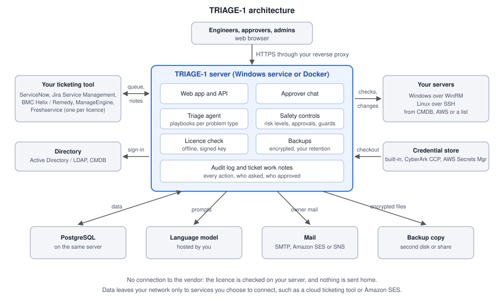

# TRIAGE-1
## The L1 site reliability engineer that works inside your ticket queue

**Product catalog and white paper · Version 1.0**

---

## 1. The problem

Most L1 incidents are repeats: a service has stopped, a disk is full, a host can't be reached, an account is locked, logs have grown too large. Each one needs the same first checks before anyone can decide what to do. Engineers spend their shifts running those checks by hand, copying results into tickets, and waiting for the right person to approve a fix.

TRIAGE-1 does that first line of work. It picks up incidents from your ticket queue, checks the affected servers, records what it found on the ticket, and fixes what is safe to fix. For anything riskier, it puts the evidence in front of a person and asks.

## 2. What TRIAGE-1 does

### 2.1 Automatic triage
- Watches your L1 queue and picks up new incidents.
- Identifies the server and the type of problem, then follows a **playbook** for that problem type. A playbook lists the checks to run and the fixes allowed.
- Runs checks such as reachability, disk usage, service state, recent errors, memory pressure, large files and service logs.
- Writes its findings, and every action it takes, as work notes on the ticket.
- Applies low-risk fixes on its own, waits for an approver on medium-risk fixes, and never automates high-risk ones.
- Comes back after a fix to confirm the problem has gone, and reopens the ticket if it hasn't.

### 2.2 Approver chat
Engineers type requests in plain language, such as "is the print spooler running on app-srv-01?", "what's using the disk on web-02?" or "restart it".

| Type of request | Examples | How it runs |
|---|---|---|
| **Read-only checks** | Uptime, pending reboot, network and DNS from the server, recent errors, sessions, failed services, scheduled jobs, Windows update status, installed and upgradable Linux packages | Runs straight away and is recorded in the audit log |
| **Changes** | Stop or start a service, change startup type, log off a session, run a scheduled job, install or update Linux packages | Shows an exact action card, and runs only when the engineer clicks **Confirm** |
| **High-risk changes** | Reboot, shut down, remove packages, install Windows updates | Also needs the **server owner's approval by email** before Confirm |

- Each change opens a ticket owned by the engineer and adds a work note with the result.
- Package changes are simulated first, so the card shows exactly what would be installed or removed.

### 2.3 Owner approval by email
1. TRIAGE-1 finds the server's owners in your CMDB: the owner, the manager, the support group and an optional owner mailbox field.
2. It sends them a request with a reference code.
3. The engineer pastes the owner's reply into the chat. TRIAGE-1 checks that the reference code matches and the request has not expired. It also checks that the reply comes from one of the owners and contains clear approval wording, with no refusal or conditions.
4. The approval is stored on the ticket.
5. After the change, the owners receive a result email.

### 2.4 Knowledge and context
- Chat answers draw on your **ServiceNow knowledge base**, with the most relevant articles chosen and cited.
- When a server is named, TRIAGE-1 adds its CMDB context: what depends on it, its owner, its support group and how critical it is.

### 2.5 Administration
- Behaviour is set in the admin panel, with no code changes: playbooks, risk levels, approval rules, lists of protected services and packages, mail templates, schedules and limits.
- **Roles:** user, approver, auditor, admin and super admin. Sign-in can use Active Directory or LDAP with group mapping.
- TRIAGE-1 monitors its own health, including requests, errors and timings, and keeps that data for a period you set.

## 3. Safety by design

| Control | What it means for you |
|---|---|
| **The model never chooses a change** | A fixed table maps each request to a tool. The model only fills in names, such as a service or package. |
| **Signed action cards** | What the engineer confirms is exactly what runs. The browser cannot change it. |
| **Risk levels** | Low-risk actions run, medium-risk actions need a person's Confirm, high-risk actions also need the owner's approval, and the highest-risk actions are refused. Thresholds are yours to set. |
| **Protected lists** | Services and packages you mark as protected are never stopped or removed. Remote-access and core system components are protected by default. |
| **No privilege escalation** | On Linux, `sudo` is used only for fixed commands. It is never used to gain a shell, edit permissions or change accounts. |
| **Self-protection** | TRIAGE-1 never reboots or shuts down the server it runs on. Reboots of the same server are spaced apart. |
| **Short-lived credentials** | Server credentials are taken from your credential store only for the action, with an hourly limit per person, and every use is audited. |
| **Complete record** | Every change is written on the ticket, and every action is in the audit log with who asked and who approved. |
| **Your model, your network** | The language model is hosted by you. Ticket and server data are not sent to a public AI service. |

## 4. Architecture



```
  Engineers, approvers, admins (browser)
                 |  HTTPS through your reverse proxy
                 v
 +--------------------------------------------------+
 |  TRIAGE-1 server (Windows service or Docker)      |
 |   Web app and API      Approver chat              |
 |   Triage agent         Safety controls            |
 |   Licence check        Encrypted backups          |
 |   Audit log and ticket work notes                 |
 +--------------------------------------------------+
   ^  queue, notes          checks, changes  |
   |                                          v
 Your ticketing tool                   Your servers
 (one per licence)               (Windows WinRM, Linux SSH)
                                          ^
 Directory (AD / LDAP, CMDB) -> sign-in   |  checkout
                                   Credential store
   |                |                 |               |
   v                v                 v               v
 PostgreSQL    Language model       Mail          Backup copy
 (same server) (hosted by you)  (SMTP/SES/SNS)  (disk or share)
```

TRIAGE-1 runs on one server inside your environment. It never connects to the vendor. Data leaves your network only to services you choose to connect, such as a cloud ticketing tool or Amazon SES.

## 5. Connectors

| Area | Supported |
|---|---|
| Ticketing (one per licence) | ServiceNow, Jira Service Management, BMC Helix / Remedy, ManageEngine ServiceDesk Plus, Freshservice |
| Server inventory | ServiceNow CMDB, Amazon EC2, a list you maintain |
| Credentials | Built-in encrypted store, CyberArk Central Credential Provider, AWS Secrets Manager |
| Servers | Windows (WinRM), Linux (SSH, `apt` and `dnf`/`yum` systems) |
| Sign-in | Local accounts, Active Directory / LDAP with group-to-role mapping |
| Notifications | SMTP, Amazon SES, Amazon SNS |
| Knowledge | ServiceNow Knowledge Base |
| Language model | Any OpenAI-compatible endpoint you host |

## 6. Editions

| | **Starter** | **Team** | **Commander** |
|---|---|---|---|
| Managed servers | 25 | 100 | Unlimited |
| Approver seats | 2 | 10 | 50 |
| Automatic tickets per month | 200 | 1,500 | 10,000 |
| Automatic triage, playbooks, verification | Yes | Yes | Yes |
| Approver chat, read-only checks | Yes | Yes | Yes |
| Approver chat, changes | | Yes | Yes |
| Owner approval by email and high-risk changes | | | Yes |
| Telemetry export and alerts | | | Yes |
| Encrypted backups, audit log, role-based access | Yes | Yes | Yes |

Custom limits are available. The licensing guide covers how licences work.

## 7. Deployment

| Option | Contents |
|---|---|
| **Windows installer** | One setup file. It installs TRIAGE-1 and a bundled PostgreSQL, and registers TRIAGE-1 as a Windows service that starts automatically and restarts itself after a failure. It runs under its own low-privilege service account. |
| **Docker** | A container image and a Compose file with its own PostgreSQL. It runs as a non-root user, and all data is kept on one volume. |

- **Network:** TRIAGE-1 listens only on the local machine by default. Your reverse proxy provides HTTPS to users.
- **Licence:** checked offline, so isolated networks are supported.
- **Updates:** install the new version over the old one. Your data and settings are kept, and the Windows installer takes a backup before it changes anything.

## 8. Data protection and backups

**Your data stays in your database.** Users, settings, audit records, run history and approvals are kept in PostgreSQL on your server. Chat conversations are kept in each user's own browser.

**Secrets are encrypted at rest.** Stored credentials and secret settings are encrypted with a key unique to your installation.

**Backups run daily and are encrypted by default.**
- Backups use AES-256-GCM, with a recovery key that you hold.
- You set the retention: keep every backup for a number of days, one a week for a number of weeks, and one a month for a number of months. The newest backup is never deleted.
- Each backup can be copied automatically to a second disk or network share.
- The admin panel warns you, and an alert email is sent, when backups are late, failing or not being copied.
- A restore is run by an administrator. It checks the recovery key, makes a safety backup of the current data, and restores in a single step that either completes fully or changes nothing.

**Retention and privacy.** See the Data Retention Notice and the Privacy and Erasure Notice.

## 9. Licensing at a glance

- You receive a signed licence key that is checked offline on your server.
- Limits are soft, with warnings at 80% and a 14-day grace period.
- After the grace period, only new automatic tickets pause. People can always sign in, chat and approve.
- Full details are in the TRIAGE-1 Licensing Guide.

## 10. System requirements

| | Windows | Docker |
|---|---|---|
| Operating system | Windows Server 2019 or later, 64-bit | Linux x86-64 with Docker Engine and Compose |
| Processor and memory | 4 CPU cores, 8 GB RAM minimum | 4 CPU cores, 8 GB RAM minimum |
| Disk | 20 GB plus backups | 20 GB plus backups |
| Database | PostgreSQL 17, included | PostgreSQL 17 container, included |
| Network | WinRM or SSH to managed servers, plus HTTPS to your ticketing tool, credential store and mail service | Same |
| Language model | OpenAI-compatible endpoint, hosted separately | Same |

## 11. Documents in this pack
- TRIAGE-1 Licensing Guide
- End User Licence Agreement
- Third-Party Software Notices
- Data Retention Notice
- Privacy and Erasure Notice
- Administrator Procedures (for database administrators)
